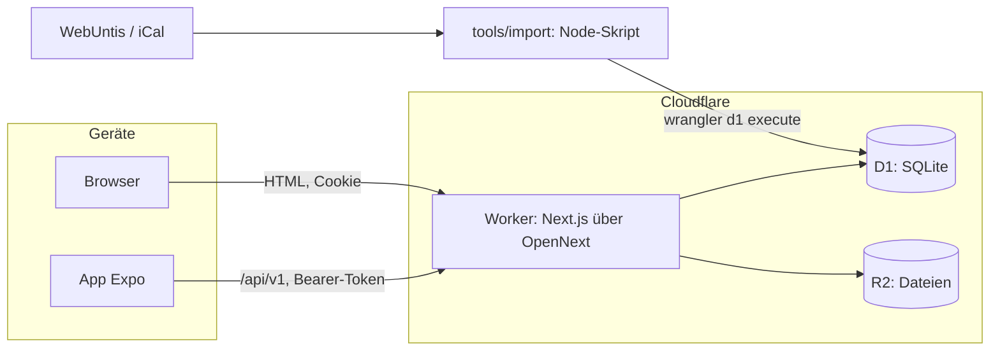
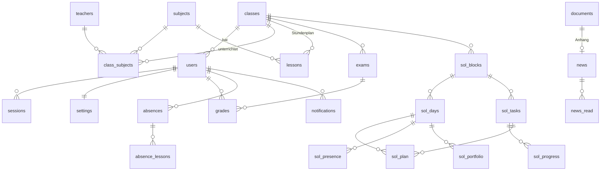

# bwd Portal: Projektdokumentation

Schulprojekt. Die Demo-Konten zeigen erfundene Daten (Selin Hofer, Klasse IM24b). Echt sind die Lektionenzeiten, der Stundenplan der Klasse IM24a (von Hand aus WebUntis übertragen) und ihre SOL-Daten: Blöcke 1 bis 8 aus der SOL-Einführung, 89 Aufträge mit Zeitvorgabe aus SharePoint, Präsenzen aus WebUntis. Stand: November 2026.

## 1. Ziel

Lernende der bwd finden heute Stundenplan, Noten, Absenzen, SOL-Aufträge, Mitteilungen und Dokumente an fünf Orten: WebUntis, SOL-UP, Moodle, SharePoint und die Website. Das Portal bündelt diese Informationen an einem Ort, als Website und als App für iOS und Android.

Umfang (alle Screens aus dem Design): Login, Übersicht, Stundenplan (Tag, Woche), Noten, Fach, Absenzen (Cockpit wie in der Absenzendatenbank: Kontingent, Absenzen, Abmeldungen, Dispensationsgesuche), SOL (Aufträge, Kalender mit Einplanen, Portfolio mit Check-in und Check-out), Mitteilungen, Mitteilung, Dokumente mit Suche und Filter, Links, Benachrichtigungen, Profil und Einstellungen, 404. Hell und dunkel. Zustände: lädt, leer, Fehler.

Nicht im Umfang: Ansicht für Lehrpersonen, echte Push-Nachrichten, echte Noten oder Absenzen aus Schulsystemen, weitere Sprachen.

## 2. Ergebnis

| Teil | Wo |
|---|---|
| Web | https://bwdportal.planary.ch |
| App | Expo Go (`pnpm dev:mobile`, QR-Code scannen) oder Android-APK über EAS |
| Web als App | Installierbar (PWA) über "Zum Home-Bildschirm" |
| Code | Monorepo, siehe [README](../README.md) |

## 3. Architektur

- **Ein Monorepo** mit pnpm-Workspaces. `packages/shared` enthält alles, was Web und App gleich brauchen: Typen und Zod-Schemas, die Zeitraster-Rechnung, Datum und Noten, Design-Tokens, Icons und den API-Client. `packages/db` enthält Schema, Seed und eine Abfrage pro Screen.
- **Web**: Next.js App Router. Seiten sind Server Components und lesen direkt aus D1. Interaktives (Dialoge, Formulare, Regler) sind Client Components, die die API aufrufen.
- **App**: Expo Router mit vier Tabs. Jeder Tab hat einen eigenen Stack, darum bleibt die Tab-Bar auf Unterseiten sichtbar wie im Design. Die App liest alles über `/api/v1` und prüft jede Antwort mit Zod.
- **Login**: Schnittstelle `AuthProvider` (`signIn`, `signOut`, `getSession`) mit zwei Umsetzungen. `MockAuthProvider` mit Demo-Konten und `MicrosoftAuthProvider` (Entra ID, OpenID Connect mit PKCE): der Server tauscht den Code gegen ein ID-Token, prüft Signatur, Aussteller, Empfänger und Nonce und lässt nur die Schul-Domain zu. Die App meldet sich über das Portal an und bekommt einen Einmal-Code (60 Sekunden), den sie gegen ihr Token tauscht; Rücksprung nur in die App (kein offener Redirect). Sessions liegen in D1: im Web als HttpOnly-Cookie, in der App als Bearer-Token im SecureStore.
- **Offline**: Die App speichert die letzte gute Antwort jeder Ansicht auf dem Gerät und zeigt sie ohne Verbindung mit dem Stand an. Beim Abmelden wird der Speicher gelöscht. Im Web speichert der Service Worker nur Skripte, Schriften und eine Offline-Seite, keine persönlichen Daten.
- **Kalender-Abo**: Privater Link pro Person (`/api/v1/calendar/<token>.ics`) mit Lektionen, Prüfungen und SOL-Plan im iCalendar-Format (Zeitzone Europe/Zurich). Ein neuer Link macht den alten ungültig.
- **Zeit**: Im Deployment gilt die echte Zeit in Europe/Zurich, die Jetzt-Linie wandert jede Minute. Lokal setzt `DEMO_NOW` (in `.dev.vars`) die Zeit auf den Stichtag der Beispieldaten (26.10.2026, 10:20), für Tests und Screenshots.
- **Klasse**: Neue Microsoft-Konten kommen in die Klasse aus `DEFAULT_CLASS` (IM24a), bis die Zuordnung aus dem Schulsystem kommt.
- **Stundenplan-Import**: Quellen `webuntis`, `ical`, `file` (JSON, von Hand übertragen) und `mock`. Das Banner "WebUntis antwortet gerade nicht" erscheint, wenn der letzte Lauf fehlschlug oder ein laufender Abgleich (WebUntis, iCal) älter als ein Tag ist. Daten aus einer Datei oder die Beispieldaten veralten nicht.
- **Absenzen**: Nach dem Absenzenreglement WMB/IMS (gültig ab 1.8.2025). Lehrpersonen erfassen die Absenzen; Lernende melden sich vorher ab (Datum, von Lektion bis Lektion, Bemerkung) und stellen Dispensationsgesuche (Grund, Lektionen, Bestätigung). Die Rechnung steht einmal in `packages/shared/src/domain.ts`: Kontingent IMS 20 Lektionen pro Semester (Art. 3a), durch ein bewilligtes Gesuch gedeckte Lektionen zählen nicht (Art. 6b), ohne Abmeldung vor Beginn der Lektion doppelt (Art. 5c), was das Kontingent übersteigt gilt als unentschuldigt (Art. 8a), die Überschreitung kürzt das Kontingent im nächsten Semester (Art. 8b). Fachkontingent: höchstens doppelte Wochenlektionen pro Fach (Art. 3d). Gesuche brauchen eine Bestätigung, ausser ab dem 2. Krankheitstag, und gelten unter 5 Arbeitstagen im Voraus als verspätet (Art. 4b, 4d). Abmeldungen lassen sich bis zum Beginn ändern, Gesuche solange sie eingereicht sind.
- **Konfiguration**: Alle Adressen der Schule stehen in `config/portal.json`, die unbestätigten als Platzhalter markiert. Im Code steht keine Adresse fest.

## 4. Datenmodell

Schema nach `handoff/data/schema.sql`, umgesetzt mit Drizzle (`packages/db/src/schema.ts`). Zeiten sind Wandzeit als Text (`2026-10-26`, `10:45`).

Ohne Beziehungen: `import_runs` (Importläufe), `links`, `periods` (Lektionenzeiten).

Ergänzungen zum Vorschlag:

| Ergänzung | Grund |
|---|---|
| `class_subjects` | Lehrperson pro Fach und Klasse (Noten, SOL) |
| `notifications.icon` | Icon der Benachrichtigung wie im Design |
| `sol_presence.lane` | Spur im SOL-Kalender (vier Spuren) |
| `links.badge`, `links.accent` | Kürzel und Farbe der Kachel |
| `documents.sort` | Reihenfolge wie im Design |
| `login_codes` | Einmal-Code für die App nach dem Microsoft-Login |
| `calendar_tokens` | Geheimer Link fürs Kalender-Abo |

Die Beispieldaten entstehen aus `handoff/data/fixtures.json`. Wo die Fixtures Lücken haben, ist ergänzt und begründet (`packages/db/src/seed/build.ts`): Prüfungen der übrigen Fächer so, dass alle Schnitte genau dem Design entsprechen, Stundenplan der Wochen 41 bis 51 nach dem Muster der Woche 44, und ein zweites Demo-Konto ohne Noten und Absenzen für die Leerzustände.

## 5. Entscheide

| Thema | Entscheid | Begründung |
|---|---|---|
| Web | Next.js 16 | Server Components lesen direkt aus D1, eine Codebasis für Seiten und API |
| App | Expo SDK 58 | Eine Codebasis für iOS und Android, vorführbar in Expo Go ohne Build |
| Hosting | Cloudflare Workers, D1, R2 | Kostenlos für ein Schulprojekt, Datenbank und Dateien ohne eigenen Server |
| Caching | `cacheComponents` aus | Jede Seite hängt von der Session ab, das alte Modell ist einfacher und läuft sicher auf OpenNext |
| Proxy (Middleware) | entfernt | Node-Middleware ist auf OpenNext experimentell. Jede Seite prüft die Session selbst auf dem Server |
| Zeit im Deployment | echt, `DEMO_NOW` nur lokal | Der echte Stundenplan soll am richtigen Tag erscheinen. Lokal bleibt der Stichtag für Tests und den Vergleich mit dem Design |
| Absenzen | Cockpit der Absenzendatenbank statt "Absenz entschuldigen" aus dem Design | An der Schule entschuldigen Lernende nicht nachträglich; sie melden sich ab, Lehrpersonen erfassen, das Kontingent rechnet. Ablauf und Gründe wie in der Absenzendatenbank, Regeln aus dem Reglement |
| Echte SOL-Daten | Aufträge aus den SharePoint-Dokumenten gelesen, `pnpm sol:import` | Titel und Zeitvorgabe stehen in den Dokumenten. Die Dokumente selbst kommen nicht ins Portal: die Demo-Konten sind offen, und es sind Unterlagen der Schule |
| Echter Stundenplan | von Hand aus WebUntis in eine JSON-Datei, Import mit `--source file` | Schneller als der API-Zugang; die Datei liegt in `tools/import/.local/` und nicht im Repo |
| Login | Microsoft (Entra ID) und Demo-Konten | Der echte Login läuft mit einer eigenen Test-Registrierung; für die Schule genügt deren Client-ID. Demo-Konten bleiben für die Vorführung |
| App-Login | über das Portal mit Einmal-Code | Die App braucht keine eigene Registrierung und kein Secret; der Code gilt 60 Sekunden und nur einmal |
| Offline im Web | nur statische Dateien | Seiten mit Noten und Absenzen sollen nicht im Browser-Speicher liegen |
| Stundenplan | Import statt Live-Zugriff | Das Paket `webuntis` läuft nur in Node, nicht auf Workers. Das Portal speichert keine WebUntis-Passwörter, und die Demo läuft auch ohne WebUntis |
| Schriften | im Repo (woff2, OFL) | Keine Abhängigkeit von Google Fonts zur Build-Zeit, selbst gehostet wie verlangt |
| Design-Werte | aus `tokens.json` erzeugt | `pnpm tokens` schreibt CSS-Variablen und das RN-Theme; ein Test prüft, dass beide synchron sind |
| Vergangene Lektionen | gemischte Fläche statt 50 % Deckkraft | Mit 50 % Deckkraft fällt der Text unter 4.5:1. Der Block ist weiterhin blasser, der Text bleibt lesbar |
| Etikett der Jetzt-Linie | dunkle Schrift auf Rot | Weiss auf `now` erreicht nur 3.9:1, dunkel 4.9:1 |

## 6. Tests

| Ebene | Werkzeug | Was |
|---|---|---|
| Rechnung | Vitest (`packages/shared`, 51 Tests) | Zeitraster (Massstab, Jetzt-Linie, vergangene Blöcke, Spuren), Datum und Formate, Notenschnitt und Rundung, Absenzenreglement (Kontingent, doppelt ohne Abmeldung, Kürzung, verspätete Gesuche), Tokens synchron |
| Daten | Vitest (`packages/db`, 37 Tests) | Echte Migration und Seed in SQLite im Speicher. Kennzahlen wie im Design (4.9, 25 Prüfungen, 1 ungenügend), Schreiben (Abmeldung, Gesuch, Einplanen, Portfolio, Einstellungen), Suche, Stand des Imports, Standardklasse für Microsoft-Konten |
| Import | Vitest (`tools/import`, 11 Tests) | Abbildung WebUntis und iCal, Upsert-SQL, SOL-Blöcke aus Kalenderwochen |
| App | Jest mit jest-expo und React Native Testing Library (12 Tests) | Zeitraster (Beschriftung, Jetzt-Linie, Kontrast vergangener Lektionen), Offline-Verhalten, Grundkomponenten (Rollen und Zustände) |
| Login | Vitest (`apps/web`, 5 Tests) | PKCE, Authorize-URL, Domain-Prüfung, kein offener Redirect |
| Wege im Web | Playwright (40 Tests, Desktop und Pixel 7) | Login und Abmelden, alle Routen mit genau einer H1, Stundenplan, Note ansehen, Kontingent und Fachkontingent, Abmeldung eintragen, ändern und löschen, Gesuch mit Pflicht-Bestätigung, SOL einplanen, Portfolio, Dokumente, Benachrichtigungen, Profil |
| Barrierefreiheit | axe-core (7 Tests) | WCAG 2.2 AA auf allen Seiten in hell und dunkel, Desktop und Mobile; Skip-Link und sichtbarer Fokus |
| CI | GitHub Actions | Typecheck, Lint, Unit-Tests bei jedem Push |

Die Playwright-Tests laufen lokal mit `DEMO_NOW`. Vor jedem Test werden die Demo-Daten zurückgesetzt (`POST /api/v1/dev/reset`, nur im Demo-Modus). Das Deployment läuft mit echter Zeit, darum dort keine Playwright-Tests mehr.

## 7. Prüfung nach Checkliste

| Punkt | Stand |
|---|---|
| Titel pro Route ("Noten · bwd Portal") | ja |
| Meta-Beschreibung, Open Graph, Favicon, Apple-Icon | ja, erzeugt mit `apps/web/scripts/gen-assets.mjs` |
| 404 im Portal | ja |
| Zustände lädt, leer, Fehler | ja (Skeleton, Leerzustand, Fehler mit "Erneut laden") |
| Tastatur, Fokus, Skip-Link | ja, getestet |
| Kontrast | axe ohne Befund, hell und dunkel |
| Breiten | Sidebar ab 901 px, Icon-Leiste 600 bis 900 px, App-Layout darunter |
| Konsole | ohne Fehler (geprüft bei jedem Screenshot) |
| `prefers-reduced-motion`, `prefers-contrast` | berücksichtigt |

## 8. Reflexion

**Was gut lief**
- Die gemeinsame Rechnung in `packages/shared` hat sich gelohnt: Zeitraster, Noten und Fristen sind einmal geschrieben und getestet, Web und App zeigen dieselben Werte.
- Tests gegen die echte Migration statt gegen Mocks haben mehrere Fehler früh gezeigt, etwa den Klassenschnitt (gewichtet 4.5, im Design 4.4) und die Reihenfolge der Importläufe bei gleicher Minute.
- Screenshots nach jedem Schritt und der Vergleich mit `handoff/design/screens` haben kleine Abweichungen sichtbar gemacht (Abstände, Fokusring im Dialog, Seitenleiste auf langen Seiten).

**Was nicht geklappt hat und warum**
- **WebUntis nicht gegen den echten Server getestet**: Servername, Schulname und die Erlaubnis der Schule fehlen (offene Frage 3). Der Import ist gebaut und getestet, mit Zugang sollte er ohne Änderung laufen. Ohne Zugang schlägt er sauber fehl und der Stundenplan zeigt das Banner. Für die Klasse IM24a ist der Stundenplan darum von Hand aus WebUntis übertragen (Woche 49, wiederholt bis 18.12.2026).
- **Lektionenzeiten**: Die angenommenen acht Lektionen stimmten nicht. Die echten elf Lektionen (08:00 bis 17:45, ohne feste Mittagspause) stehen jetzt in `config/portal.json`; das Band "Mittag" liegt in der Pause 12:30 bis 12:35.
- **Microsoft-Login der Schule**: Der Login ist gebaut und läuft mit einer eigenen Test-Registrierung. Für Konten der bwd braucht es die Registrierung oder Zustimmung der Schule.
- **Expo Router 58** hat die Navigation umgebaut. Die erste Tab-Leiste reagierte nicht, weil die Tabs ihre Auslöser direkt im JSX erwarten. Gelöst, aber es hat Zeit gekostet.
- **Zwei Wettläufe** wurden erst durch Tests sichtbar: schnelle Änderungen am SOL-Fortschritt konnten sich überholen, und die App markierte beim Antippen einer Benachrichtigung alle als gelesen. Beide sind behoben.
- **Design und Kontrast** widersprechen sich an zwei Stellen (vergangene Lektionen, Etikett der Jetzt-Linie). Ich habe mich für die Lesbarkeit entschieden und das dokumentiert.

**Was ich nächstes Mal anders mache**
- Barrierefreiheit (axe) von Anfang an in den Tests, nicht erst am Schluss.
- Die offenen Fragen an die Schule früher stellen, damit der echte Import vor der Abgabe getestet werden kann.

## 9. Offene Punkte

Siehe [handoff/docs/OFFENE-PUNKTE.md](../handoff/docs/OFFENE-PUNKTE.md). Die Platzhalter-Adressen stehen in `config/portal.json`. Weiter offen: Links der SOL-Aufträge auf SharePoint, Präsenzen der SOL-Tage ausser Block 4, Stundenplan der Blockwoche (KW 48) und nach den Winterferien, Zustimmung der Schul-IT für Konten der bwd. Später: echte Push-Nachrichten, Rolle Lehrperson.
