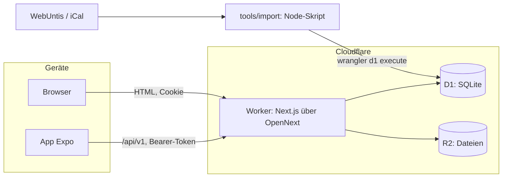
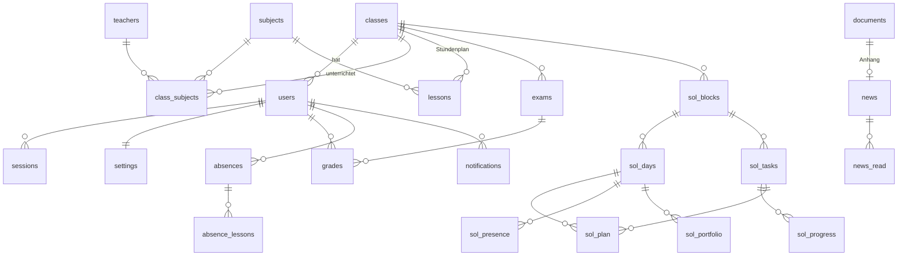

# bwd Portal: Projektdokumentation

Schulprojekt. Alle Daten im Portal sind erfunden (Selin Hofer, Klasse IM24b). Stand: November 2026.

## 1. Ziel

Lernende der bwd finden heute Stundenplan, Noten, Absenzen, SOL-Aufträge, Mitteilungen und Dokumente an fünf Orten: WebUntis, SOL-UP, Moodle, SharePoint und die Website. Das Portal bündelt diese Informationen an einem Ort, als Website und als App für iOS und Android.

Umfang (alle Screens aus dem Design): Login, Übersicht, Stundenplan (Tag, Woche), Noten, Fach, Absenzen mit "Absenz entschuldigen", SOL (Aufträge, Kalender mit Einplanen, Portfolio mit Check-in und Check-out), Mitteilungen, Mitteilung, Dokumente mit Suche und Filter, Links, Benachrichtigungen, Profil und Einstellungen, 404. Hell und dunkel. Zustände: lädt, leer, Fehler.

Nicht im Umfang: Ansicht für Lehrpersonen, echte Push-Nachrichten, echte Noten oder Absenzen aus Schulsystemen, weitere Sprachen.

## 2. Ergebnis

| Teil | Wo |
|---|---|
| Web | https://bwd-portal.planary.workers.dev |
| App | Expo Go (`pnpm dev:mobile`, QR-Code scannen) oder Android-APK über EAS |
| Code | Monorepo, siehe [README](../README.md) |

## 3. Architektur

- **Ein Monorepo** mit pnpm-Workspaces. `packages/shared` enthält alles, was Web und App gleich brauchen: Typen und Zod-Schemas, die Zeitraster-Rechnung, Datum und Noten, Design-Tokens, Icons und den API-Client. `packages/db` enthält Schema, Seed und eine Abfrage pro Screen.
- **Web**: Next.js App Router. Seiten sind Server Components und lesen direkt aus D1. Interaktives (Dialoge, Formulare, Regler) sind Client Components, die die API aufrufen.
- **App**: Expo Router mit vier Tabs. Jeder Tab hat einen eigenen Stack, darum bleibt die Tab-Bar auf Unterseiten sichtbar wie im Design. Die App liest alles über `/api/v1` und prüft jede Antwort mit Zod.
- **Login**: Schnittstelle `AuthProvider` (`signIn`, `signOut`, `getSession`). Heute `MockAuthProvider` mit Demo-Konten (`AUTH_MODE=mock`). `MicrosoftAuthProvider` (Entra ID, OIDC) ist vorbereitet, die Screens ändern sich dafür nicht. Sessions liegen in D1: im Web als HttpOnly-Cookie, in der App als Bearer-Token im SecureStore.
- **Zeit**: `DEMO_NOW` setzt die Zeit auf den Stichtag der Beispieldaten (26.10.2026, 10:20). Ohne die Variable gilt die echte Zeit in Europe/Zurich, und die Jetzt-Linie wandert jede Minute.
- **Konfiguration**: Alle Adressen der Schule stehen in `config/portal.json`, die unbestätigten als Platzhalter markiert. Im Code steht keine Adresse fest.

## 4. Datenmodell

Schema nach `handoff/data/schema.sql`, umgesetzt mit Drizzle (`packages/db/src/schema.ts`). Zeiten sind Wandzeit als Text (`2026-10-26`, `10:45`).

Ohne Beziehungen: `import_runs` (Importläufe), `links`, `periods` (Lektionenzeiten).

Ergänzungen zum Vorschlag:

| Ergänzung | Grund |
|---|---|
| `class_subjects` | Lehrperson pro Fach und Klasse (Noten, SOL) |
| `notifications.icon` | Icon der Benachrichtigung wie im Design |
| `sol_presence.lane` | Spur im SOL-Kalender (vier Spuren) |
| `links.badge`, `links.accent` | Kürzel und Farbe der Kachel |
| `documents.sort` | Reihenfolge wie im Design |

Die Beispieldaten entstehen aus `handoff/data/fixtures.json`. Wo die Fixtures Lücken haben, ist ergänzt und begründet (`packages/db/src/seed/build.ts`): Prüfungen der übrigen Fächer so, dass alle Schnitte genau dem Design entsprechen, Stundenplan der Wochen 41 bis 51 nach dem Muster der Woche 44, und ein zweites Demo-Konto ohne Noten und Absenzen für die Leerzustände.

## 5. Entscheide

| Thema | Entscheid | Begründung |
|---|---|---|
| Web | Next.js 16 | Server Components lesen direkt aus D1, eine Codebasis für Seiten und API |
| App | Expo SDK 58 | Eine Codebasis für iOS und Android, vorführbar in Expo Go ohne Build |
| Hosting | Cloudflare Workers, D1, R2 | Kostenlos für ein Schulprojekt, Datenbank und Dateien ohne eigenen Server |
| Caching | `cacheComponents` aus | Jede Seite hängt von der Session ab, das alte Modell ist einfacher und läuft sicher auf OpenNext |
| Proxy (Middleware) | entfernt | Node-Middleware ist auf OpenNext experimentell. Jede Seite prüft die Session selbst auf dem Server |
| Login | Mock-Login | Für Entra ID braucht es eine App-Registrierung der Schule. Die Schnittstelle ist vorbereitet |
| Stundenplan | Import statt Live-Zugriff | Das Paket `webuntis` läuft nur in Node, nicht auf Workers. Das Portal speichert keine WebUntis-Passwörter, und die Demo läuft auch ohne WebUntis |
| Schriften | im Repo (woff2, OFL) | Keine Abhängigkeit von Google Fonts zur Build-Zeit, selbst gehostet wie verlangt |
| Design-Werte | aus `tokens.json` erzeugt | `pnpm tokens` schreibt CSS-Variablen und das RN-Theme; ein Test prüft, dass beide synchron sind |
| Vergangene Lektionen | gemischte Fläche statt 50 % Deckkraft | Mit 50 % Deckkraft fällt der Text unter 4.5:1. Der Block ist weiterhin blasser, der Text bleibt lesbar |
| Etikett der Jetzt-Linie | dunkle Schrift auf Rot | Weiss auf `now` erreicht nur 3.9:1, dunkel 4.9:1 |

## 6. Tests

| Ebene | Werkzeug | Was |
|---|---|---|
| Rechnung | Vitest (`packages/shared`, 40 Tests) | Zeitraster (Massstab, Jetzt-Linie, vergangene Blöcke, Spuren), Datum und Formate, Notenschnitt und Rundung, Fristen, Tokens synchron |
| Daten | Vitest (`packages/db`, 28 Tests) | Echte Migration und Seed in SQLite im Speicher. Kennzahlen wie im Design (4.9, 25 Prüfungen, 1 ungenügend), Schreiben (Absenz, Einplanen, Portfolio, Einstellungen), Suche, Stand des Imports |
| Import | Vitest (`tools/import`, 8 Tests) | Abbildung WebUntis und iCal, Upsert-SQL |
| Wege im Web | Playwright (40 Tests, Desktop und Pixel 7) | Login und Abmelden, alle Routen mit genau einer H1, Stundenplan, Note ansehen, Absenz entschuldigen mit Anhang, SOL einplanen, Portfolio, Dokumente, Benachrichtigungen, Profil |
| Barrierefreiheit | axe-core (7 Tests) | WCAG 2.2 AA auf allen Seiten in hell und dunkel, Desktop und Mobile; Skip-Link und sichtbarer Fokus |
| CI | GitHub Actions | Typecheck, Lint, Unit-Tests bei jedem Push |

Die Playwright-Tests laufen lokal und gegen das Deployment (`BASE_URL=…`). Vor jedem Test werden die Demo-Daten zurückgesetzt (`POST /api/v1/dev/reset`, nur im Demo-Modus).

## 7. Prüfung nach Checkliste

| Punkt | Stand |
|---|---|
| Titel pro Route ("Noten · bwd Portal") | ja |
| Meta-Beschreibung, Open Graph, Favicon, Apple-Icon | ja, erzeugt mit `apps/web/scripts/gen-assets.mjs` |
| 404 im Portal | ja |
| Zustände lädt, leer, Fehler | ja (Skeleton, Leerzustand, Fehler mit "Erneut laden") |
| Tastatur, Fokus, Skip-Link | ja, getestet |
| Kontrast | axe ohne Befund, hell und dunkel |
| Breiten | Sidebar ab 901 px, Icon-Leiste 600 bis 900 px, App-Layout darunter |
| Konsole | ohne Fehler (geprüft bei jedem Screenshot) |
| `prefers-reduced-motion`, `prefers-contrast` | berücksichtigt |

## 8. Reflexion

**Was gut lief**
- Die gemeinsame Rechnung in `packages/shared` hat sich gelohnt: Zeitraster, Noten und Fristen sind einmal geschrieben und getestet, Web und App zeigen dieselben Werte.
- Tests gegen die echte Migration statt gegen Mocks haben mehrere Fehler früh gezeigt, etwa den Klassenschnitt (gewichtet 4.5, im Design 4.4) und die Reihenfolge der Importläufe bei gleicher Minute.
- Screenshots nach jedem Schritt und der Vergleich mit `handoff/design/screens` haben kleine Abweichungen sichtbar gemacht (Abstände, Fokusring im Dialog, Seitenleiste auf langen Seiten).

**Was nicht geklappt hat und warum**
- **WebUntis nicht gegen den echten Server getestet**: Servername, Schulname und die Erlaubnis der Schule fehlen (offene Frage 3). Der Import ist gebaut und getestet, mit Zugang sollte er ohne Änderung laufen. Ohne Zugang schlägt er sauber fehl und der Stundenplan zeigt das Banner.
- **Microsoft-Login** fehlt, weil es eine App-Registrierung in Entra ID der Schule braucht. Der Mock zeigt den Ablauf inklusive Fehlerfall.
- **Expo Router 58** hat die Navigation umgebaut. Die erste Tab-Leiste reagierte nicht, weil die Tabs ihre Auslöser direkt im JSX erwarten. Gelöst, aber es hat Zeit gekostet.
- **Zwei Wettläufe** wurden erst durch Tests sichtbar: schnelle Änderungen am SOL-Fortschritt konnten sich überholen, und die App markierte beim Antippen einer Benachrichtigung alle als gelesen. Beide sind behoben.
- **Design und Kontrast** widersprechen sich an zwei Stellen (vergangene Lektionen, Etikett der Jetzt-Linie). Ich habe mich für die Lesbarkeit entschieden und das dokumentiert.

**Was ich nächstes Mal anders mache**
- Barrierefreiheit (axe) von Anfang an in den Tests, nicht erst am Schluss.
- Die offenen Fragen an die Schule früher stellen, damit der echte Import vor der Abgabe getestet werden kann.

## 9. Offene Punkte

Siehe [handoff/docs/OFFENE-PUNKTE.md](../handoff/docs/OFFENE-PUNKTE.md). Die Platzhalter-Adressen stehen in `config/portal.json`. Später: Microsoft-Login, echte Push-Nachrichten, Rolle Lehrperson.
